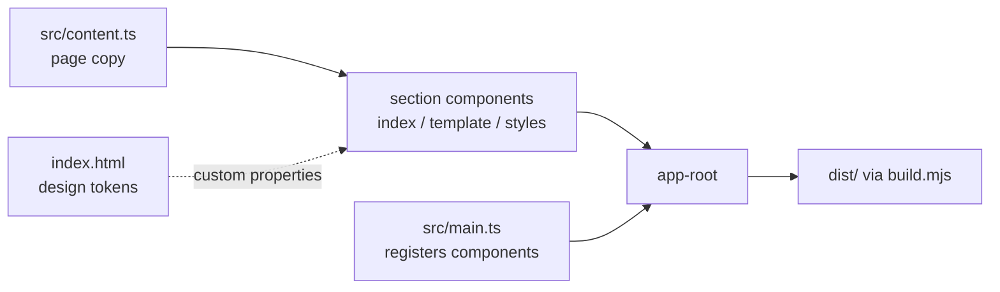

# Biolit hackathon starter

A responsive landing page skeleton in Swedish placeholder text, built with TypeScript, esbuild and
[FAST Element](https://www.fast.design/) web components. Sections: hero, services, about, cases, team, contact.

Theme: teal `#009D90` with a darker teal for small text, Montserrat for headings, Open Sans for body text,
light and dark mode (follows the system setting). There is no logo file; add your own.

## Start

```bash
npm install
npm run dev      # http://127.0.0.1:5080 with live reload, loopback only
npm run build    # type-check and bundle into dist/
```

`npm run screens` writes screenshots of `dist/` to `screens/` (375 and 1280 px, light and dark). It needs a
Chromium for Playwright: `npx playwright install chromium`.

`npm run check:links` loads `dist/` in Chromium and checks that the menu links, the hero buttons and a direct
`/#contact` load scroll to their section (build first).

## How it fits together



- `index.html` holds the design tokens (colours, spacing, fonts). Components only use `var(--...)`.
- `src/content.ts` holds all text. Change the copy there.
- Each section is a folder under `src/components/` with `index.ts`, `template.ts` and `styles.ts`.
  `services-section` is the reference pattern; `team-section` was added by following [AGENTS.md](AGENTS.md).

## Working with an AI agent

[AGENTS.md](AGENTS.md) and [CLAUDE.md](CLAUDE.md) teach the FAST Element rules and the exact recipe for adding a
section. Point your agent at them first.

## Notes

- Dev server and live reload bind to `127.0.0.1` only.
- No secrets, env files or real people's data belong in this repo.
