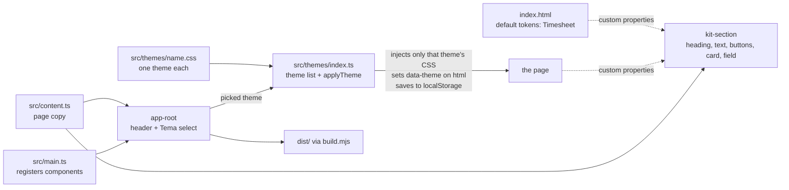

# Hackathon starter

A small page with a theme switcher, in Swedish placeholder text, built with TypeScript, esbuild and
[FAST Element](https://www.fast.design/) web components. It shows how themes plug in: a header with a "Tema"
select, and one "Exempel" block with a heading, text, a primary and a secondary button, a card and a form field.
Pick a theme in the select and every one of them changes.

Themes: Timesheet (the default, light and dark mode following the system setting), Vykort (postcards),
Redaktionell (magazine), Pipeline (developer-first, dark only) and Glädje (playful). The choice is remembered in
the browser.

## Start

```bash
npm install
npm run dev      # http://127.0.0.1:5080 with live reload, loopback only
npm run build    # type-check and bundle into dist/
```

`npm run screens` writes screenshots of `dist/` to `screens/<theme>-<width>-<mode>.png` (every theme at 375 and
1280 px, in each mode it supports). It and `npm run check:links` use Playwright's own Chromium if it is
installed, else Microsoft Edge, else the browser at `CHROMIUM_PATH`; on a machine with none of them, run
`npx playwright install chromium`.

`npm run check:links` loads `dist/` in Chromium and checks that the menu link (clicked once and again), the brand
link and a direct `/#exempel` load reach their target, and that every theme changes the background, the header
and the kit's button and is still there after a reload (build first).

## Lägg till ett eget tema

1. Kopiera en temafil i `src/themes/`, till exempel `vykort.css`, till `src/themes/mitt.css`.
2. Byt selektorn till `:root[data-theme="mitt"]` och ändra färger, typsnitt (`@import` överst) och
   `color-scheme` (`light` eller `dark`). Sätt alla färg-tokens, även `--header-bg` och `--header-text`.
3. Lägg till en rad i listan `themes` i `src/themes/index.ts`: `{ name: 'mitt', label: 'Mitt tema' },`.
4. Lägg till namnet i listan `THEMES` i `check-links.mjs` och en rad i `SHOTS` i `screenshots.mjs`
   (`['mitt', 'light']`), annars fallerar `npm run check:links` på temalistan.
5. Kör `npm run build`, `npm run check:links` och `npm run screens`, och välj temat i menyn. Text ska ha minst
   4.5:1 kontrast mot bakgrunden, inmatningsfältens kanter och fokusringen minst 3:1.

The mockup pages in [`styles/`](styles/README.md) show where each workshop style could take the layout; they are
inspiration and not part of the build.

## How it fits together



- `index.html` holds the default theme's design tokens (colours, spacing, fonts). Components only use `var(--...)`.
- A theme file overrides those tokens under `:root[data-theme="<name>"]`; the select loads only the chosen one.
- `src/content.ts` holds all text. Change the copy there.
- Each component is a folder under `src/components/` with `index.ts`, `template.ts` and `styles.ts`.
  `kit-section` is the reference pattern.

## Working with an AI agent

[AGENTS.md](AGENTS.md) and [CLAUDE.md](CLAUDE.md) teach the FAST Element rules and the exact recipes for adding a
section or a theme. Point your agent at them first.

## Notes

- Dev server and live reload bind to `127.0.0.1` only.
- Theme fonts load from Google Fonts; without a network the fallback system fonts are used.
- No secrets, env files or real people's data belong in this repo.
