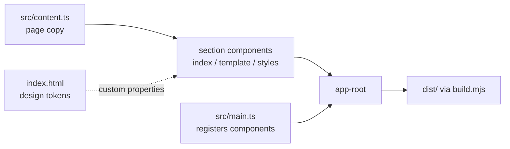

# Biolit hackathon starter

A responsive landing page skeleton in Swedish placeholder text, built with TypeScript, esbuild and
[FAST Element](https://www.fast.design/) web components. Sections: hero, services, about, cases, team, contact.

Look: deliberately neutral and technical. System fonts, grey surfaces and one plain blue accent, light and dark
mode (follows the system setting), all from design tokens in `index.html`. No brand, no logo: choosing a style is
the workshop's next step (below).

## Start

```bash
npm install
npm run dev      # http://127.0.0.1:5080 with live reload, loopback only
npm run build    # type-check and bundle into dist/
```

`npm run screens` writes screenshots of `dist/` to `screens/` (375 and 1280 px, light and dark). It and
`npm run check:links` use Playwright's own Chromium if it is installed, else Microsoft Edge, else the browser at
`CHROMIUM_PATH`; on a machine with none of them, run `npx playwright install chromium`.

`npm run check:links` loads `dist/` in Chromium and checks that every menu link (read from the page, clicked once
and again), the hero buttons, the brand link and a direct `/#contact` load scroll to their section (build first).

## Workshop step: choose a style

[`styles/`](styles/README.md) holds four example styles: Vykort (postcards), Redaktionell (magazine), Pipeline
(developer-first, dark) and Glädje (playful). Each is a mockup page you open in the browser and a `tokens.css`
with its palette and type. Pick one and ask your AI tool to apply it to the starter; the prompt and the checks are
in [styles/README.md](styles/README.md).

## How it fits together



- `index.html` holds the design tokens (colours, spacing, fonts). Components only use `var(--...)`.
- `src/content.ts` holds all text. Change the copy there.
- Each section is a folder under `src/components/` with `index.ts`, `template.ts` and `styles.ts`.
  `services-section` is the reference pattern; `team-section` was added by following [AGENTS.md](AGENTS.md).

## Working with an AI agent

[AGENTS.md](AGENTS.md) and [CLAUDE.md](CLAUDE.md) teach the FAST Element rules and the exact recipe for adding a
section. Point your agent at them first.

## Notes

- Dev server and live reload bind to `127.0.0.1` only.
- No secrets, env files or real people's data belong in this repo.
